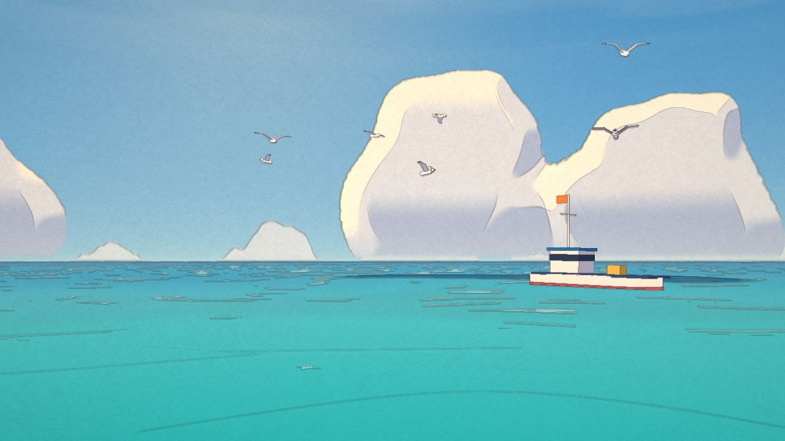
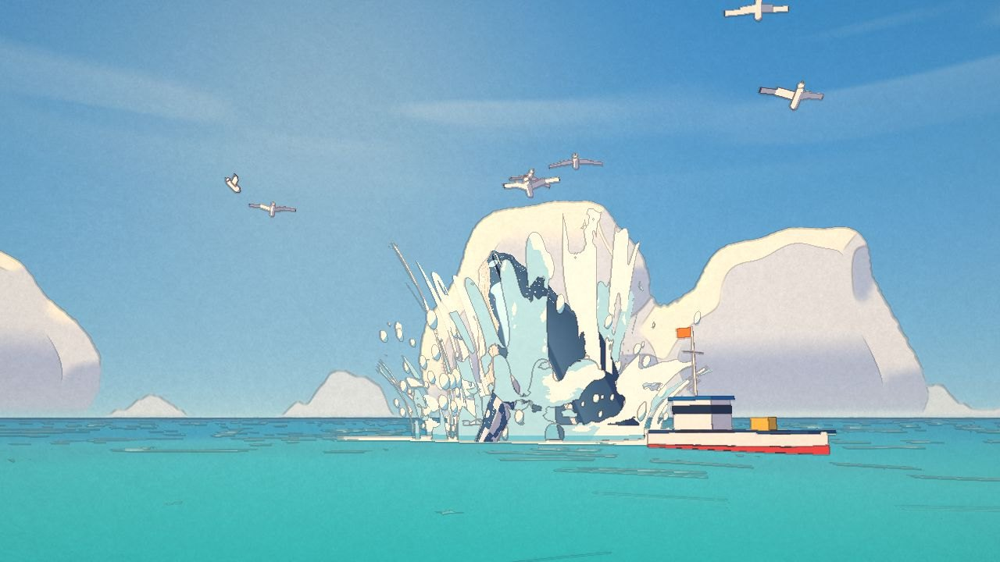
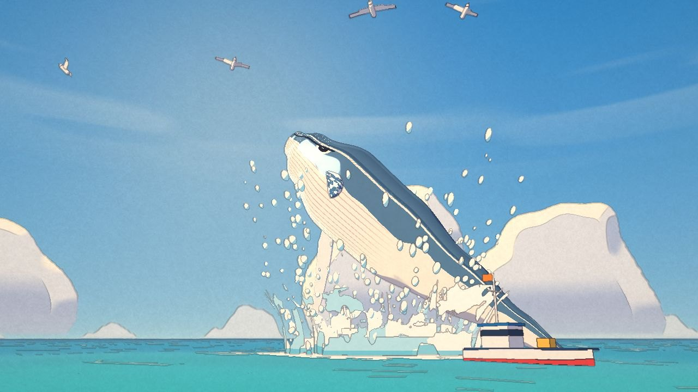
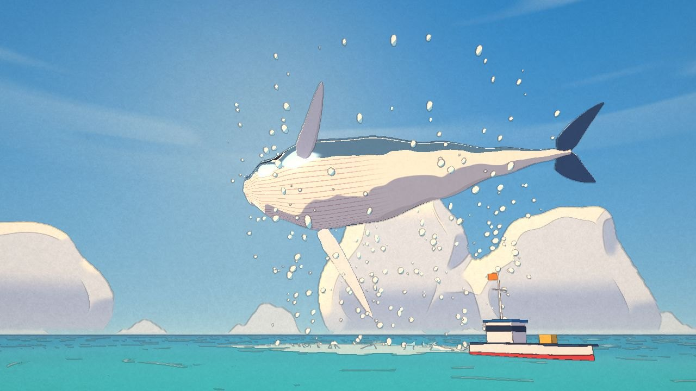
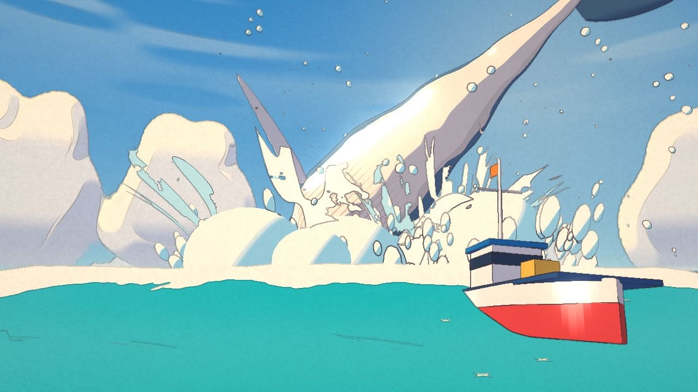
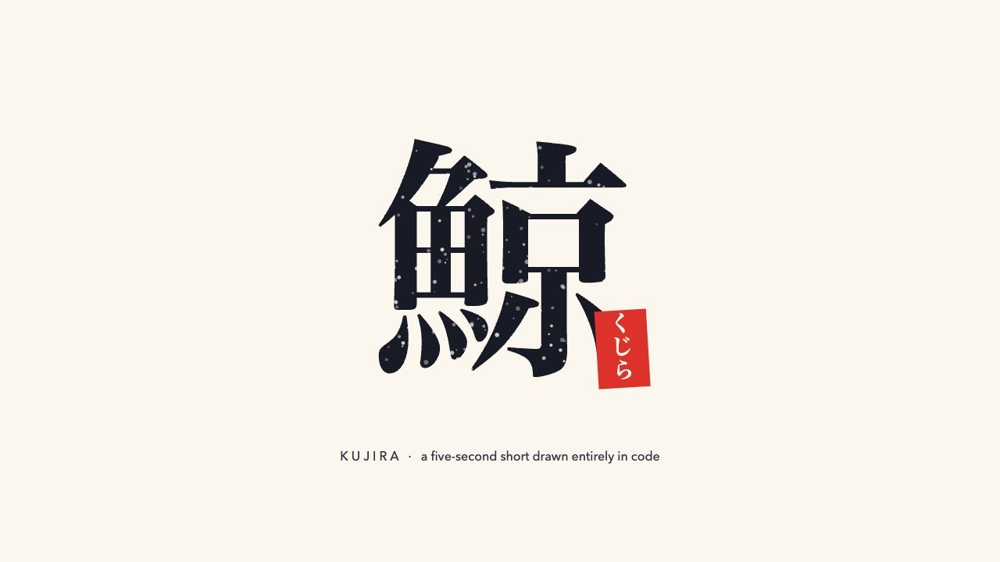

# 鯨 KUJIRA · a five-second whale, drawn in code

A humpback breaches beside a little fishing boat and falls back into a summer sea. Five seconds, rendered live in the browser with three.js in a hand-painted animation style: towering cumulus, watercolour sea, thin coloured lines. The music (a small piano tune over soft strings) and every sound are synthesized with Web Audio. There are no video, image or audio files.

**Watch:** https://henrymeihao.github.io/kujira-js/

| | | |
|---|---|---|
|  |  |  |
|  |  |  |

The look is inspired by hand-drawn Japanese animation backgrounds. It is an original short, not affiliated with any studio.

## How it works

- **Every frame is a pure function of time.** Story beats are in `CUES` in `src/00-util.js`; the whale's breach is a set of keyframe tracks in `src/60-shots.js`. Characters move on twos (12 drawings a second) and water on threes.
- **The sky is painted by a shader.** `glsl/sky_fs.glsl` builds each cumulus tower from round billows, lights them cream-white from the upper left and shades them blue-lavender.
- **The sea is drawn, not simulated.** `glsl/sea_fs.glsl` grades turquoise into ultramarine and adds hand-drawn wave strokes, drifting cloud shadows and little star-shaped sparkles.
- **Watercolour on paper.** A Kuwahara pass paints the background, pigment pools at the edges of each wash, an ink pass draws thin lines in a darker shade of whatever they outline, and the final grade prints it all on paper.
- **The whale** (`src/30-whale.js`) is a bent, rolled tube with flippers and flukes, rebuilt every drawing. The gulls (`src/55-gulls.js`) glide and scatter when it comes up.
- **Sound** (`src/70-audio.js`) is rendered when the page loads: sea, gulls, a whale's call, the water pouring off it and a soft fall back into the sea.

## Build

Needs Node 18+. No dependencies to install.

~~~bash
node build.mjs          # writes index.html, a single self-contained page
python3 -m http.server  # then open http://localhost:8000
~~~

URL parameters: `?t=2.6` jumps to a time, `?q=low` renders at 1280×720, `?headless=1` hides the player bar.

## Credits

The rendering approach follows [0xCodez/leviathan](https://github.com/0xCodez/leviathan) (MIT). The paint and ink shaders in `glsl/paint_fs.glsl` and `glsl/ink_fs.glsl` are adapted from it. three.js is MIT, see `vendor/THREE-LICENSE`.
